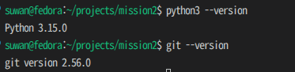
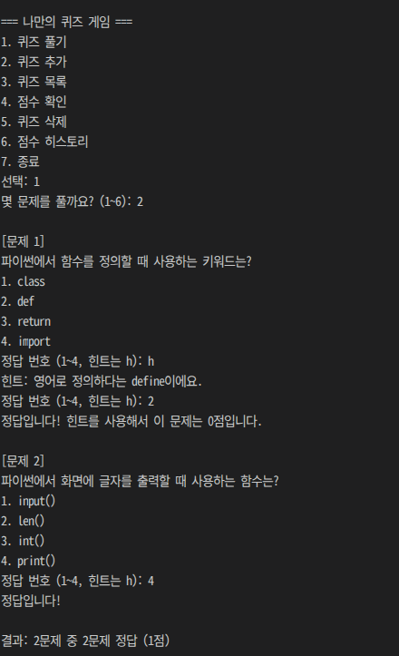
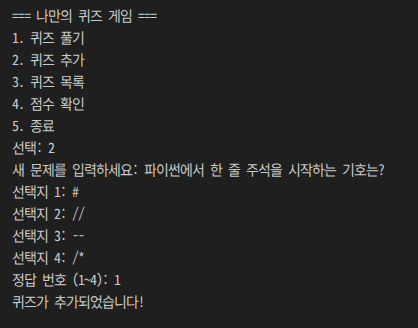
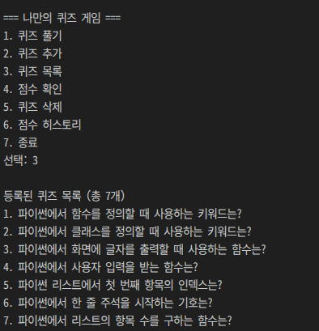
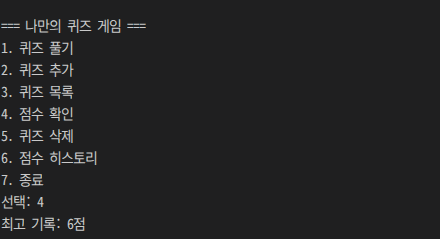
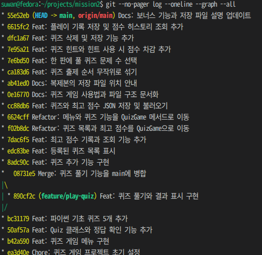
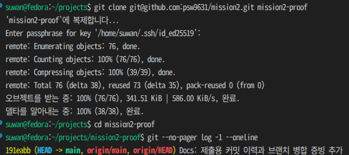
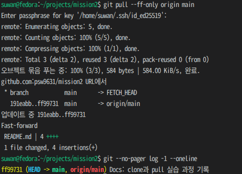

# 미션2 — 콘솔 퀴즈 게임

파이썬 기초를 복습하는 터미널 퀴즈 게임입니다. 게임을 만들면서 사용한 함수와 클래스, 입력과 출력, 리스트 인덱스를 주제로 기본 문제 5개를 만들었습니다. 직접 문제를 추가할 수 있고, 퀴즈 목록과 점수는 게임을 다시 실행해도 유지됩니다.

## 시작하기

Python 3.10 이상이 필요합니다. Python 표준 라이브러리만 사용합니다.

Git이 있다면 터미널에서 저장소를 복제한 뒤 실행합니다.

```bash
git clone https://github.com/psw9631/mission2.git
cd mission2
python3 main.py
```

Git 없이 받으려면 저장소의 **Code → Download ZIP**에서 내려받아 압축을 풉니다. VS Code에서 `main.py`가 들어 있는 폴더를 열고 **터미널 → 새 터미널**에서 `python3 main.py`를 실행합니다. Windows에서 Python 실행 명령이 `py`인 경우에는 `py main.py`를 사용합니다.



## 게임 사용법

메뉴 번호를 입력하고 Enter를 누릅니다.

| 번호 | 메뉴 | 동작 |
|---|---|---|
| 1 | 퀴즈 풀기 | 풀 문제 수를 선택하면 등록된 문제 중에서 무작위로 출제합니다. 풀이 중 `h`를 입력하면 힌트를 볼 수 있습니다. |
| 2 | 퀴즈 추가 | 문제 문장, 선택지 4개, 정답 번호를 입력해 등록합니다. |
| 3 | 퀴즈 목록 | 등록된 문제의 문장과 전체 개수를 표시합니다. |
| 4 | 최고 점수 | 한 판에서 얻은 최고 점수를 표시합니다. |
| 5 | 퀴즈 삭제 | 목록에서 문제 번호를 골라 삭제합니다. `0`을 입력하면 취소합니다. |
| 6 | 점수 히스토리 | 판별 완료 날짜와 시간, 푼 문제 수, 점수를 최근 기록부터 표시합니다. |
| 7 | 종료 | 게임을 종료합니다. |

힌트 없이 맞히면 1점, 힌트를 보고 맞히거나 틀리면 0점입니다. 결과 화면에는 맞힌 문제 수와 획득 점수를 각각 표시합니다.

### 입력 오류와 종료

- 입력 앞뒤의 공백을 제거합니다. 메뉴 번호, 문제 수, 정답 번호, 삭제할 문제 번호가 비어 있거나 허용 범위를 벗어나면 다시 입력받습니다. 문자를 입력한 경우에도 다시 묻고, 퀴즈 풀이에서는 `h`와 `H`를 힌트 요청으로 처리합니다.
- 퀴즈 추가 중 문제 문장이나 선택지가 비어 있으면 해당 항목을 다시 묻습니다. 퀴즈가 없으면 풀기·목록·삭제 메뉴에서 안내하고, 점수나 플레이 기록이 없으면 각 조회 화면에서 안내합니다.
- 메뉴 7번을 선택하거나 입력 중 Ctrl+C 또는 입력 종료(EOF)가 발생하면 종료 안내를 표시합니다. 끝까지 푼 판만 점수와 히스토리에 기록합니다.

## 실행 화면

### 퀴즈 풀기와 힌트



### 퀴즈 추가



### 퀴즈 목록



### 최고 점수



### 점수 히스토리



## 코드 구성

| 파일 또는 폴더 | 역할 |
|---|---|
| [`main.py`](main.py) | 게임 실행, 메뉴 처리, 입력 검증, 저장과 복구 |
| [`quiz.py`](quiz.py) | 개별 문제의 데이터, 출력, 정답 확인 |
| [`default_quizzes.py`](default_quizzes.py) | 처음 실행할 때 사용할 파이썬 기초 퀴즈 5개 |
| [`docs/screenshots/`](docs/screenshots) | 개발 환경, 실행 화면, Git 실습 증빙 |
| [`.gitignore`](.gitignore) | 개인 저장 파일과 임시 파일을 Git에서 제외 |

### 클래스와 함수의 역할

`Quiz`는 문제 문장, 선택지, 정답, 힌트를 한 객체에 묶고 `display()`와 `is_correct()`를 제공합니다. 기본 문제와 새로 등록한 문제에 같은 출력·판정 코드를 사용할 수 있습니다. `QuizGame`은 퀴즈 목록, 최고 점수, 플레이 기록을 관리합니다. 각 메서드는 `self`를 통해 같은 게임 상태를 사용하므로, 초기 함수 중심 구조에서처럼 기능마다 목록을 전달할 필요가 줄어듭니다.

`main()`이 메뉴에 따라 게임 메서드를 호출합니다. 예를 들어 1번을 선택하면 `QuizGame.play_quiz()`가 출제 순서와 점수를 관리하고, 각 `Quiz`의 `display()`와 `is_correct()`를 호출합니다. 정답 판정은 메뉴를 실행하거나 저장 파일을 열지 않고도 확인할 수 있습니다.

`read_number()`는 문제 수·등록할 정답 번호·삭제 번호의 숫자 검사를 맡습니다. 풀이 중 입력은 힌트 요청도 처리하는 `read_quiz_answer()`에서 받습니다. `QuizGame.save_state()`와 `QuizGame.load_state()`는 게임 진행과 별도로 JSON 변환, 파일 입출력, 복구를 담당합니다.

## 저장과 복구

게임 폴더의 `state.json`에 퀴즈 목록, 최고 점수, 플레이 기록을 UTF-8 JSON으로 저장합니다. 퀴즈를 추가하거나 삭제할 때, 또는 한 판을 끝까지 풀었을 때 저장을 시도합니다. 복제한 폴더에서 실행하면 그 폴더에 별도의 저장 파일이 생깁니다.

### 데이터 구조

| 필드 | 내용과 설계 이유 |
|---|---|
| `quizzes` | 문제마다 `question`(문장), `choices`(순서가 있는 선택지 4개), `answer`(정답 번호 1~4), `hint`(힌트 문장 또는 `null`)를 한 객체로 묶습니다. 문제를 추가하거나 삭제할 때 관련 값을 함께 다룰 수 있습니다. |
| `best_score` | 힌트 차감을 반영한 한 판의 최고 점수를 저장해 히스토리를 다시 계산하지 않고 조회합니다. `null`은 기록 없음, `0`은 실제로 얻은 0점을 뜻합니다. |
| `history` | 판마다 `played_at`(완료 시각), `question_count`(문제 수), `score`(획득 점수)를 한 객체로 저장합니다. 이후 문제 목록이 달라져도 당시 몇 문제를 풀었는지 확인할 수 있습니다. |

### 자동 백업과 오류 처리

1. 저장할 때 새 데이터를 같은 파일시스템의 임시 파일에 끝까지 쓴 뒤 `state.json`을 교체합니다. 이전 정상 저장본이 있으면 교체 전에 `state.json.bak`에 한 개를 보관합니다. 교체 전에 프로그램이 중단되면 기존 원본이 남습니다.
2. 시작할 때 `state.json`의 JSON 형식과 값을 검사합니다. 원본이 없거나 읽기·검사에 실패하면 같은 기준으로 백업을 검사합니다. 정상 백업이 있으면 안내를 표시하고 백업 데이터로 시작합니다.
3. 두 파일 모두 사용할 수 없으면 기본 퀴즈 5개와 빈 기록으로 시작합니다. 읽기·검사 오류가 발생하면 안내를 표시합니다.

백업에서 시작했다면 메뉴 3번·4번·6번에서 복구된 데이터를 확인할 수 있습니다. 원본은 다음 정상 저장 때 교체됩니다. 퀴즈 추가나 삭제 중 저장에 실패하면 오류를 알리고 목록 변경을 되돌립니다. `state.json`과 `state.json.bak`은 Git에서 제외합니다.

### JSON을 선택한 이유

텍스트 편집기로 내용을 볼 수 있고 Python 표준 라이브러리로 읽고 쓸 수 있어, 한 사람이 소규모 퀴즈를 로컬에 저장하기에 적합합니다. 현재 방식은 시작할 때 전체 파일을 읽고, 저장할 때 전체 데이터를 다시 씁니다. 기록이 많거나 날짜별 조회가 잦아지면 필요한 행만 추가하거나 조회할 수 있는 SQLite가 대안입니다. SQLite를 사용하려면 테이블 구조와 SQL 쿼리도 관리해야 합니다.

## 수정할 때 참고할 곳

| 바뀌는 요구사항 | 수정할 곳 | 확인할 동작 |
|---|---|---|
| 메뉴 이름이나 번호 | `main.py`의 `QuizGame.show_menu()`, `main()` | 화면의 번호와 실제 기능이 일치하는지 확인합니다. |
| 기본 문제와 힌트 | `default_quizzes.py`의 `DEFAULT_QUIZZES` | 저장 파일이 없는 복제본에서 실행해 새 기본 문제를 확인합니다. |
| 선택지 개수나 정답 범위 | `QuizGame.add_quiz()`, `read_answer()`, `read_quiz_answer()`, `QuizGame._load_state_file()`, `DEFAULT_QUIZZES` | 등록·풀이·파일 검사에 같은 규칙을 적용하고 `Quiz.display()`의 출력도 확인합니다. |
| 출제 방식이나 점수 규칙 | `QuizGame.play_quiz()`. 힌트 입력 방식도 바뀌면 `read_quiz_answer()` | 한 판 결과, 최고 점수, 히스토리를 확인합니다. |
| 저장 필드나 히스토리 형식 | `QuizGame.save_state()`, `QuizGame._load_state_file()`. 기록 필드가 바뀌면 `play_quiz()`, `show_history()` | 이전 파일과 새 파일을 각각 불러오고, 백업 복구와 재실행 후 값 유지도 확인합니다. |

## Git 작업 기록

### 커밋과 브랜치 병합

프로젝트는 GitHub의 `main`에 업로드했습니다. [전체 커밋 기록](https://github.com/psw9631/mission2/commits/main/)과 아래 그래프에서 커밋 10개 이상을 확인할 수 있습니다.

`main`에서 기존 메뉴와 기본 퀴즈를 계속 실행할 수 있도록 퀴즈 풀기 기능은 `git checkout -b feature/play-quiz`로 만든 브랜치에서 개발했습니다. 출제와 정답 판정을 확인해 커밋한 뒤 `git checkout main`으로 돌아와 `git merge --no-ff feature/play-quiz`로 병합하고, `main`에서 다시 실행했습니다. 그래프에서 기능 커밋 `890cf2c`와 병합 커밋 `08731e5`를 확인할 수 있습니다.


### 커밋 규칙

한 커밋에 목적이 같은 변경을 묶고, 메시지는 `유형: 변경 요약` 형식으로 작성했습니다. 퀴즈 추가, 목록 표시, JSON 저장·불러오기는 동작을 확인한 뒤 별도 커밋으로 남겼습니다.

| 유형 | 실제 메시지 예시 |
|---|---|
| `Feat` | `Feat: 퀴즈 추가 기능 구현` |
| `Fix` | `Fix: 저장 실패 시 퀴즈 추가와 삭제 되돌리기` |
| `Refactor` | `Refactor: 메뉴와 퀴즈 기능을 QuizGame 메서드로 이동` |
| `Docs` | `Docs: 퀴즈 게임 사용법과 파일 구조 문서화` |
| `Merge` | `Merge: 퀴즈 풀기 기능을 main에 병합` |
| `Chore` | `Chore: 퀴즈 게임 프로젝트 초기 설정` |

### clone과 pull 실습

`mission2-clone`에 저장소를 복제하고, 복제본에서 README 변경 커밋 `ab41ed0`을 푸시했습니다. 원본 `mission2`에서 `git pull`을 실행해 같은 커밋과 README 변경이 반영된 것을 확인했습니다.

아래는 증빙을 위해 실습을 다시 진행한 화면입니다. `mission2-proof`에 복제하고 README 변경을 푸시한 뒤, 원본에서 `git pull --ff-only origin main`으로 커밋 `ff99731`을 받았습니다.




