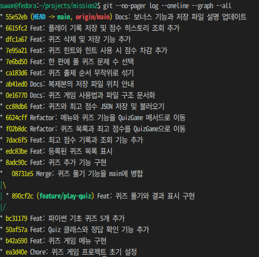

# 미션2 — 콘솔 퀴즈 게임

Python으로 만드는 터미널 퀴즈 게임입니다.

## 퀴즈 주제와 선정 이유

퀴즈 주제는 파이썬 기초입니다. 게임을 만들면서 직접 사용한 함수와 클래스 정의, 입력과 출력, 리스트 인덱스를 문제로 풀면서 복습하기 위해 이 주제를 골랐습니다.

## 실행 방법

Python 3.10 이상이 필요합니다. 외부 라이브러리는 설치할 필요가 없습니다.

프로젝트 폴더에서 터미널을 열고 아래 명령을 실행합니다.

```bash
python3 main.py
```

메뉴 번호를 입력하고 Enter를 누릅니다. 종료하려면 7번을 선택합니다.

## 기능 목록

- 퀴즈 풀기(1번) · 문제를 풀고 맞힌 개수와 획득 점수를 확인합니다.
- 퀴즈 추가(2번) · 문제 문장, 선택지 4개, 정답 번호를 입력해 새 문제를 등록합니다.
- 퀴즈 목록(3번) · 등록된 문제의 문장과 전체 개수를 확인합니다.
- 최고 점수 확인(4번) · 한 판에서 얻은 최고 점수를 확인합니다.
- 랜덤 출제 · 매 판 등록된 문제 중에서 무작위 순서로 출제합니다.
- 문제 수 선택 · 퀴즈를 시작할 때 이번 판에 풀 문제 수를 고릅니다.
- 힌트와 점수 차감 · 풀이 중 `h`를 입력하면 힌트를 볼 수 있습니다. 힌트 없이 맞히면 1점, 힌트를 보고 맞히면 0점입니다.
- 퀴즈 삭제(5번) · 목록에서 문제 번호를 골라 삭제합니다. `0`을 입력하면 취소합니다.
- 점수 히스토리(6번) · 플레이 날짜와 시간, 푼 문제 수, 점수를 최근 기록부터 확인합니다.

## 데이터 저장 파일

`state.json`은 프로젝트 폴더에 생성되는 UTF-8 JSON 파일입니다.
퀴즈를 추가하거나 삭제할 때, 또는 한 판을 끝까지 풀었을 때 현재 데이터를 저장합니다.

- `quizzes`는 퀴즈 목록입니다. 각 문제에는 `question`(문제 문장), `choices`(선택지 4개), `answer`(정답 번호 1~4), `hint`(힌트 문장)가 들어 있습니다. 힌트가 없으면 `hint`는 `null`입니다.
- `best_score`는 힌트 차감을 반영한 한 판의 최고 점수입니다. 아직 플레이 기록이 없으면 `null`입니다.
- `history`는 완료한 플레이의 기록 목록입니다. 각 기록에는 `played_at`(플레이를 마친 날짜와 시간), `question_count`(푼 문제 수), `score`(획득 점수)가 들어 있습니다.

게임을 시작할 때 이 파일을 읽습니다. 파일이 없거나 데이터가 잘못된 경우 기본 퀴즈 5개와 기록 없음 상태로 시작합니다.
`state.json`은 `.gitignore`에 등록되어 있어 GitHub에 올리지 않습니다.

## 파일 구조

```text
mission2/
├── main.py             # 게임 실행, 메뉴 처리, 저장과 불러오기
├── quiz.py             # 문제 출력과 정답 확인을 담당하는 Quiz 클래스
├── default_quizzes.py  # 기본 퀴즈 5개
├── state.json          # 퀴즈 목록, 최고 점수, 플레이 기록을 저장하며 첫 저장 시 생성
├── .gitignore          # Git에서 제외할 파일과 폴더
└── README.md           # 프로젝트 안내
```
복제한 폴더에서 게임을 실행하면 그 폴더에 별도의 `state.json`이 생성됩니다.

## 제출 증빙 · GitHub 커밋과 브랜치 병합

- **평가 #5 · GitHub 업로드 및 커밋 10개 이상**  
  프로젝트를 GitHub의 `main` 브랜치에 업로드했습니다. [전체 커밋 기록](https://github.com/psw9631/mission2/commits/main/)과 아래 그래프에서 커밋 이력을 확인할 수 있습니다.
- **평가 #6 · 브랜치 생성 및 병합**  
  `feature/play-quiz` 브랜치에서 퀴즈 풀기 기능을 구현한 뒤 `main`에 병합했습니다. 아래 그래프에 작업 커밋 `890cf2c`와 병합 커밋 `08731e5`가 표시됩니다.



## 제출 증빙 · #7 clone과 pull 실습

GitHub의 `mission2` 저장소를 별도 폴더인 `mission2-clone`에 `git clone`으로 복제했습니다. 복제본에서 README를 수정한 커밋 `ab41ed0`을 GitHub에 푸시한 뒤, 원본 `mission2` 폴더에서 `git pull`을 실행해 같은 커밋과 README 변경이 반영된 것을 확인했습니다.

